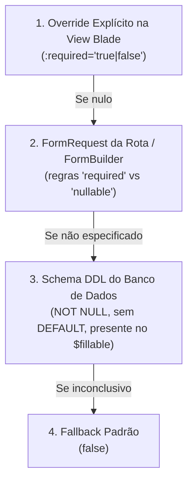

# Formulários e Imagens (`Form`, `Image`)

Esta seção documenta utilitários avançados para inferência inteligente de metadados em formulários HTML e manipulação de arquivos visuais.

---

## 📝 Helper `Form`

O helper `Form` provê inteligência de alto nível para renderização de formulários em Blade, resolvendo com precisão:
1. **Preenchimento inteligente de valores (`Form::value`):** Precedência em cascata com suporte nativo a PHP Enums (`BackedEnum`).
2. **Resolução de obrigatoriedade (`Form::isRequired`):** Determina se um campo deve ter o asterisco visual e o atributo HTML `required` através de um sistema de **Fallback Cascade de 4 Níveis**.

- **Classe:** `Softtan\Toolbox\Helpers\Form`
- **Substitui:** `FormSupport`

```php
use Softtan\Toolbox\Helpers\Form;
```

---

### Resolução de Valores de Formulário (`Form::value`)

Determina o valor a ser impresso no atributo `value` de um `<input>`, `<select>` ou `<textarea>` seguindo a ordem de precedência:
1. `old($name)` da sessão (dados digitados anteriormente pelo usuário em caso de erro de validação).
2. Atributo do Model Eloquent ativo na tela (com extração automática do valor primitivo caso o atributo seja um `BackedEnum`).
3. Valor padrão `$default` informado na view.

```php
public static function value(string $name, ?Model $model = null, mixed $default = null): mixed
```

#### Exemplo em Blade
```blade
<input type="text"
       name="email"
       value="{{ \Softtan\Toolbox\Helpers\Form::value('email', $usuario, 'contato@padrao.com') }}"
       class="form-control">
```

---

### Resolução de Obrigatoriedade (`Form::isRequired` - Fallback Cascade)

A determinação de que um campo é obrigatório (`required`) é resolvida dinamicamente através de 4 níveis de inteligência:



1. **Nível 1 - Override Explícito na View Blade:**
   Se o desenvolvedor passar `:required="true"` ou `:required="false"` na tag do componente Blade, essa instrução tem prioridade absoluta.
2. **Nível 2 - Regras de Validação do FormRequest:**
   Inspeciona o `FormRequest` associado ao formulário ativo. Se o campo possuir a regra `'required'` e não tiver `'nullable'`, é considerado obrigatório. Suporta *dot-notation* e *wildcards* (ex: `vagas.*`).
3. **Nível 3 - Schema DDL do Banco de Dados via Model:**
   Inspeciona as colunas da tabela no banco de dados via `Schema::getColumns($table)`.
   O campo será inferido como obrigatório se:
   - For `NOT NULL`;
   - Não possuir valor padrão (`DEFAULT NULL`);
   - Não for coluna de autoincremento ou gerada;
   - Estiver presente no array `$fillable` do Model Eloquent;
   - Não fizer parte das colunas de sistema reservadas (`id`, `uuid`, `created_at`, `updated_at`, `deleted_at`, `remember_token`, etc.).
   > **Otimização de Performance:** O resultado da análise de schema de cada tabela é armazenado em cache persistente de 24 horas (`schema_required_cols_{$tabela}`).
4. **Nível 4 - Fallback:**
   Retorna `false` caso nenhuma regra torne o campo obrigatório.

```php
public static function isRequired(
    string $name,
    ?Model $model = null,
    ?FormBuilder $form = null,
    ?bool $explicit = null
): bool
```

---

## 🖼️ Helper `Image`

Reservado para operações visuais e utilidades com arquivos de imagens no sistema.

- **Classe:** `Softtan\Toolbox\Helpers\Image`
- **Substitui:** `ImageSupport`
